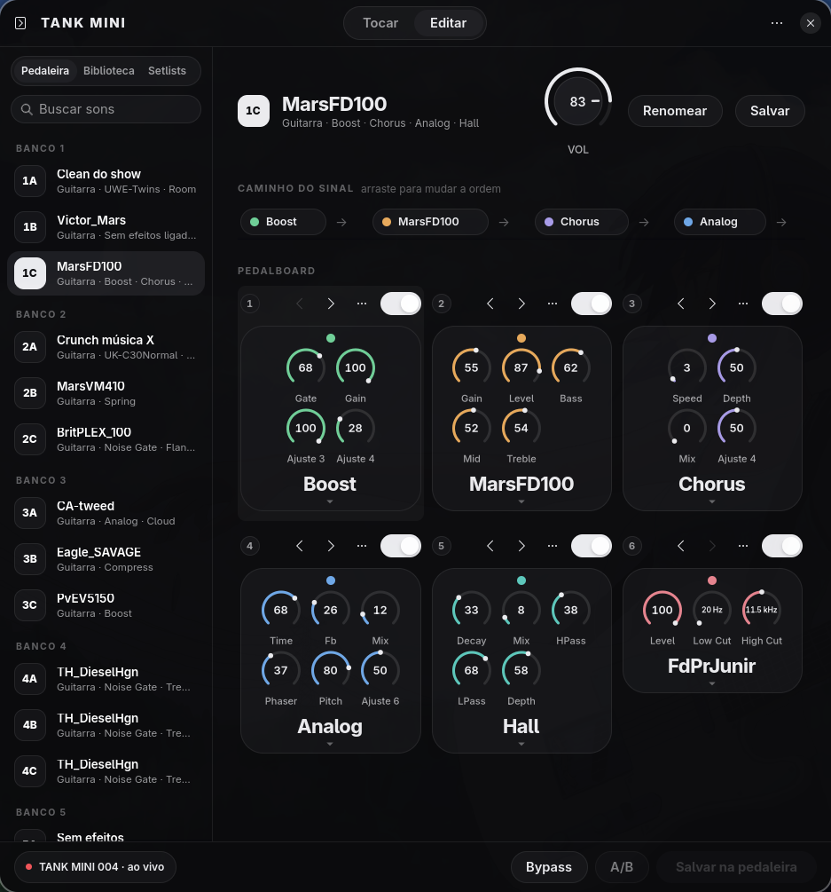
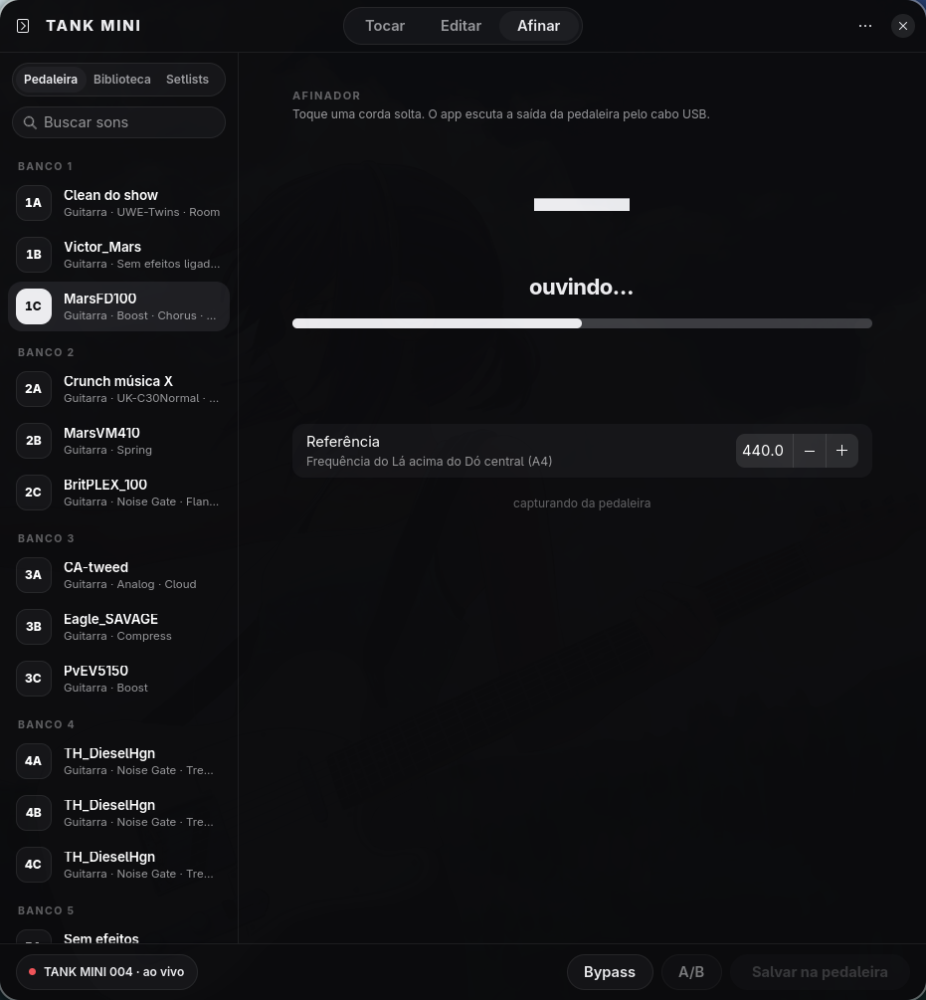

# TANK MINI for Linux

[](https://github.com/viniciusapl97/tankmini-linux/actions/workflows/ci.yml)
[](LICENSE)

A native Linux app for the **M-VAVE TANK MINI** guitar/bass multi-effects pedal. It
talks to the pedal over plain USB-MIDI, using a protocol reverse-engineered from the
official M-EFCS Android app and confirmed byte by byte on real hardware.

No Android phone, no proprietary runtime, no cloud: plug the pedal in with a USB cable
and the app finds it.






The interface is in Brazilian Portuguese. Everything below works without the phone
app — and much of it the phone app does not offer at all (preset names, backups,
export/import, a sound library, undo, a real signal-chain view).

## Why

The pedal is good; the vendor app is not. It needs an Android phone, edits one preset
at a time, and its notion of "save" is generous. This project keeps the pedal's own
sound engine — no firmware is touched — and adds what a desktop can give you: a real
window, keyboard, backups, bulk editing, and a documented protocol.

## Features

**Tocar (for playing)**
- Current preset with four big knobs: Volume, Drive, Brilho, Ambiente.
- Every effect as a coloured pill, on/off with one click.
- "Sons prontos": ready-made starting points per instrument (guitarra, violão, baixo).
- First-run assistant that explains the pedal and the app.

**Editar (for tweaking)**
- The six blocks drawn as a pedalboard in signal order, with the model on each card
  and the LED/power state.
- Every parameter of every block, with real names and units (cab cuts in Hz,
  model-specific knobs).
- Chain reorder by drag or arrows — the pedal allows any order and so does the app.
- Live editing through the pedal's edit buffer: the sound changes while you turn a
  knob; flash is only written when you ask.
- Undo/redo, A/B against the saved version, copy/paste a block, factory values.
- Raw bytes panel with unsaved bytes highlighted.
- Backup before every write, read-back verification after every write.

**Afinar**
- Chromatic tuner reading the pedal's own USB audio input: note, cents, which way to
  turn the peg ("aperte"/"afrouxe a corda") and the nearest string of standard tuning.
- Adjustable A4 reference (415–466 Hz), live capture status, works while the pedal is
  also being monitored through the speakers.
- Detection is a tested autocorrelation/YIN implementation that survives the case a
  naive detector fails: a plucked string whose second harmonic is louder than the
  fundamental.

**Utility**
- Local preset names (the pedal has no name field, only bank + A/B/C).
- Export/import a single preset or the whole table, copy a preset to another slot.
- Factory reset from a byte-exact embedded factory table, behind a confirmation.
- Sound library with tags and favourites, setlists, search, backups browser.
- Hot-plug, footswitch-follow, theme (dark/light/system), preferences, keyboard
  shortcuts (`Ctrl+?`).
- CLI with `--json` output for scripting.

## Requirements

| | |
|---|---|
| OS | any Linux with USB-MIDI (ALSA `rawmidi`); no distro-specific code |
| Toolkit | **GTK 4.14+** and **libadwaita 1.5+** |
| Rust | 1.75 or newer |
| Device | M-VAVE TANK MINI over USB (`4c4a:c755`), firmware `TANK MINI_004` tested |

Current releases of Arch, Fedora 40+, Ubuntu 24.04+, Debian 13, openSUSE Tumbleweed
and NixOS unstable ship toolkits new enough. On older releases the toolkit itself is
too old — there is nothing distro-specific to patch, you need a newer libadwaita
(build it, use a Flatpak, or use a current distro).

The app opens `/dev/snd/midiC*D*` directly, so your user must be allowed to. On most
desktops that is automatic; if the app reports a permission error:

```sh
sudo usermod -aG audio "$USER"   # then log out and back in
```

## Install

```sh
git clone https://github.com/viniciusapl97/tankmini-linux
cd tankmini-linux

# dependencies — pick your distro
sudo pacman -S --needed base-devel rust gtk4 libadwaita                 # Arch
sudo dnf install gcc rust cargo gtk4-devel libadwaita-devel             # Fedora
sudo apt install build-essential cargo libgtk-4-dev libadwaita-1-dev    # Debian/Ubuntu
sudo zypper install gcc cargo gtk4-devel libadwaita-devel               # openSUSE

./install.sh    # builds and installs tankmini, tankmini-gui and a menu entry in ~/.local
```

Try it without installing:

```sh
cargo run --release -p tankmini-gui
```

Useful environment variables: `TANKMINI_DEMO=0` runs with no pedal attached (factory
table, preset 1A loaded), `TANKMINI_INSTANCE=dev` allows a second, independent window.

## Play along with your computer

The pedal is already a USB audio interface, so playing guitar over a YouTube
backing track needs no fork and no extra app: PipeWire just has to mix the pedal's
input into the output you already hear.

```sh
tools/tankmini-audio.sh headphones   # guitar + system audio in the same headphones
tools/tankmini-audio.sh pedal        # pedal becomes the default output (phones in the pedal)
tools/tankmini-audio.sh status       # what PipeWire sees
```

`headphones` runs a `pw-loopback` at 128 frames (~3 ms) from the pedal's capture to
your current sink, so the guitar and the video arrive together; Ctrl+C removes it.
This is the same capture path the tuner screen reads from, so nothing is exclusive.

## Command line

The GUI and the CLI share one core crate, so anything the app does can be scripted.
`tankmini --help` lists everything; a few examples:

```sh
tankmini devices                  # list USB-MIDI devices and identify the pedal
tankmini show                     # decode the current preset block by block
tankmini slot 4                   # switch the pedal to preset 5
tankmini patch 3 --param 2=80     # edit one parameter of slot 4
tankmini save                     # commit the working table to flash
tankmini export 3 solo.tankmini   # export a single preset
tankmini import 12 solo.tankmini  # import into slot 13 (backup + verify)
tankmini copy 3 9                 # duplicate a preset
tankmini name 3 "Crunch música X" # local name for a preset
tankmini bypass on                # global bypass
tankmini library add "Solo do show"
tankmini raw read 4 0x10000000 92 # raw protocol access
```

`--json` makes `show`, `patch`, `backups`, `names`, `library` and `templates`
machine-readable.

## How it works

The pedal speaks a SysEx-like framing over USB-MIDI:

```
f0  <7-bit packed: 00 59 <cmd> <len u24 LE> <body> <checksum>>  f7
checksum = (~sum(body)) & 0xff
```

A preset is 1942 bytes: 21 records of 92 bytes (bank/ABC, on/off per block, model per
block, six 16-bit parameters per block) plus a `PATCHEND` trailer. Blocks are written
in 173-byte chunks with an ACK per chunk and a full read-back afterwards;
`WRITE 0xF0000000` with an empty body commits RAM to flash. Live edits go through a
separate edit buffer (`0x10000000`), which is why turning a knob never touches flash.

The full map — edit buffer, global/bypass byte, amp and cab name tables, the IR upload
path we have not tried, and which findings are `verified` on hardware versus recovered
`from app` — lives in [`docs/protocol/`](docs/protocol):

- [`tank-mini-usb-sysex.md`](docs/protocol/tank-mini-usb-sysex.md) — framing, commands, addresses
- [`preset-map.md`](docs/protocol/preset-map.md) — every byte of the 92-byte record
- [`app-findings.md`](docs/protocol/app-findings.md) — the official app's memory map

## Safety

This tool writes to the pedal's flash. It does so carefully — backup before every
write, read-back verification, no blind addressing — but it is unofficial and comes
with no warranty. Two rules the project follows strictly:

- The `ERASE` command (`0x21`) is never sent. It exists in the app, it is not needed,
  and there is no known recovery path.
- Nothing is written outside the known preset window (`type 4`, `0x0000`–`0x0795`)
  until that address has been read at least once.

Firmware updates are deliberately out of scope.

## Status

Verified on hardware: transport, identity, preset read/write/save, slot switching,
live edit buffer, bypass, backups, export/import, copy, factory reset, CLI.

Not done yet: cabinet/IR upload (20 slots, `AM2` format — the address is known from the
app but has never been tried), amp capture import, remote tuner, Bluetooth. The
protocol docs mark exactly which claims have evidence and which do not.

## Development

```sh
cargo test --workspace     # core protocol tests, no hardware required
cargo build --release
cargo run -p tankmini-core --example live_probe   # hardware check of live editing
```

```
docs/protocol/   protocol notes, one file per topic (evidence-marked)
docs/specs/      specs, written before implementation
assets/          factory-table.bin, byte-exact dump of the stock presets
tools/           probing / capture tooling (Python, stdlib only)
captures/        raw dumps and extracted app assets (git-ignored)
```

Contribution rules (evidence tags, spec-first changes, the two write-safety rules) are
in [`AGENTS.md`](AGENTS.md).

## Reference material

Prior art for the same M-VAVE protocol family (different devices, same framing):

- [`marco-jardim/mvave-irbox-tools`](https://github.com/marco-jardim/mvave-irbox-tools) — frame format, 8→7 packing, checksum, region map
- [`pferreir/cuvave-midi`](https://github.com/pferreir/cuvave-midi) — Cube Baby memory map
- [`Pinudo/cubebaby-tools`](https://github.com/Pinudo/cubebaby-tools), [`aroum/fm1-custom-fw`](https://github.com/aroum/fm1-custom-fw)

## Legal

Reverse engineering here is limited to interoperability with hardware we own: the pedal
on this desk and the official app binaries. No firmware is redistributed, no cracked
tools are used, and the project is not affiliated with M-VAVE. "TANK MINI" is a
trademark of its owner; this project only claims interoperability.

## License

MIT — see [`LICENSE`](LICENSE).
